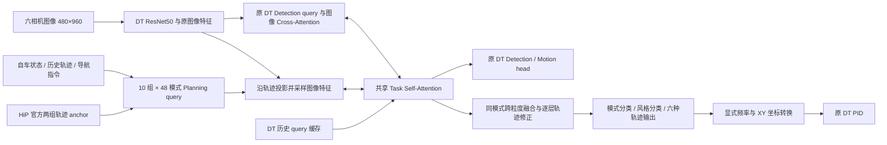

# DT-HiP：保留 DT 检测，移植 HiP 规划，移除 Mapping

2026-10-12。首轮实验，尚无本模型的闭环结果。

## 设计目标

以 DriveTransformer 的 DT-Base 为骨架，保留 detection 与 motion prediction 的计算路径和监督，将原有 ego planning 替换成 HiP-AD 风格的多粒度多模态规划。按本次要求彻底关闭 mapping：不构建 map query、地图预测头，不读取地图标注，不计算地图 loss。

“检测保持一致”指检测 query、检测图像 cross-attention、检测 head、匹配与 loss 的设计保持一致；检测仍参与联合训练。由于 Task Self-Attention 的规划 token 从 1 个增加为 480 个且移除了 map token，检测接收到的交互上下文会变化，因此不能承诺检测数值或精度不变。

共享 decoder 保留 DT 的任务交互和时序注意力。Planning 用沿轨迹采样的图像注意力替换其原来的全图注意力；detection 仍走原来的全图注意力。道路几何由图像采样和任务交互隐式学习，没有地图输出和地图监督。

## Planning 的具体定义

每个 query 预测当前 LiDAR 坐标系下 6 个绝对 XY 点，XY 为 `[right, forward]`，单位米。每层输出 `B×10×48×6×2`。

| 组 | 预测内容 | 6 个点的含义 |
|---|---|---|
| 0 | 5 Hz 时间轨迹 | 0.2–1.2 s |
| 1 | 2 m 空间轨迹 | 距当前原点 2–12 m |
| 2 | 2 Hz 时间轨迹 | 0.5–3.0 s |
| 3 | 5 m 空间轨迹 | 距当前原点 5–30 m |
| 4–6 | 停车／慢速／正常的 5 Hz 轨迹 | 三种速度风格 |
| 7–9 | 停车／慢速／正常的 2 Hz 轨迹 | 与上面同样三种风格 |

这 480 个 query 同时处理，并非先粗选再细选。同一个模式索引在四个基础粒度之间对齐；融合四个基础组的特征后输出一个 48 类模式评分。再结合两种频率下的风格特征，预测该模式的三种速度风格。风格 GT 来自 5 Hz 未来运动的平均速度，阈值为 0.4 和 3 m/s。

轨迹 anchor 直接使用 HiP-AD 发布的 Bench2Drive `2m` 和 `5m` 两个 npy 文件，保留其模式顺序。注意 `2m` 文件实际初始化为短直线射线，不等于初始化点就在 2、4、…、12 m 处；2 m 是该输出组的监督采样间隔。

每层对六个 waypoint 加可学习 XY 偏移，在 5 个高度、每个高度 3 个偏移位置采样：每 query 共 90 个三维采样点，投影到六相机。使用增强后的 `lidar2img` 和实际图像 padding 尺寸，仅在可见点／相机上归一化。全不可见时图像更新为零。首版只读取 DT 现有的单层图像特征，保持 backbone 和 detection 的特征路径不变。

与原 HiP 的其他区别：采用 DT 自车状态／历史／导航初始化 query；保留原 140 维导航输入（近、远命令各 6 维，近、远目标点位置编码各 64 维），包含几何导航信息；沿用 DT 时序缓存，每帧仅缓存选中模式四个基础组的平均特征；轨迹回归最后一层零初始化，起始输出等于发布的 anchor；保留 DT PID，不移植 HiP 的碰撞重评分及控制器。

## 监督与梯度

时间标签按真实 frame index 和 0.1 s 数据周期采样，缺帧不会压缩时间。空间标签读取同一路段剩余位姿，按离当前原点的**径向距离**匹配 2 m／5 m 采样点，遵循官方最近点、递增 index 和距离误差门槛，不误用累计弧长。无效 pose、路线边界、缺失时间点均使用 mask。

Align Matching 先用 2 m 空间 GT 与 48 个候选计算有效点上的 ADE，选出一个模式，四种基础轨迹和速度风格共用此模式监督。空间 GT 全无效时，改用 2 Hz 时间 GT 匹配；两者都无效则屏蔽该样本。这个显式 fallback 是本实现为停车及路线末尾加入的处理。

每个 decoder 层计算模式分类、基础轨迹回归、风格分类及对应风格轨迹回归；分类权重 0.5、回归权重 1。只监督匹配模式与 GT 对应的速度风格，其他模式仍参与分类。Detection / motion 的监督保留，mapping 和旧 DT planning loss 不执行。新增 GT 只传给 loss，不进入模型输入特征。

## 推理与控制接口

1. 选最高分模式，再选该模式的最高分风格。
2. 横向使用选中模式的 2 m 空间 XY；按弧长重采样成原 DT PID 所需的 1 m 路径。这是控制接口转换，不改变训练标签定义。
3. 纵向使用选中风格的 5 Hz 时间 XY，线性插值到 10 Hz，保留原 PID 的速度计算时间窗口。如果风格类别与普通 5 Hz 预测的速度类别不一致，退回普通 5 Hz 轨迹。
4. 所有轨迹明确从 `[right, forward]` 转成 PID 的 `[forward, right]`。超过预测空间路径末端时钳制，不外推未预测道路。
5. 旧开环评估需要的 30 个时间点由选中 2 Hz／3 s 轨迹插值得到；其结果应标注为插值评估，不是一个额外的 10 Hz 预测 head。

## 首轮训练与可行性门槛

模型基线：`RockWenJJ/DriveTransformer` 的 `dev_wenjj`，起始提交 `9721083a7a515a3aec3955c364980e3955b6ecda`。HiP 代码依据提交 `9610ed83a89145433fe77da04a0077b42013994c`。这是一种新混合模型，不是 HiP-AD 的等价复现。

首轮采用现有 DT-Base 480×960 训练配方：ResNet50 预训练初始化，其余从头训练；train950 / val50；4×A100，20 samples/GPU，全局 batch80，29,350 iteration，约 10 epoch。沿用 AdamW、学习率 1e-4、cosine schedule、warmup1000、仓库现有混合精度实现（配置名为 FP16，实际是 BF16 autocast）与原有梯度裁剪。没有感知预训练阶段；smoke 的权重不会进入正式训练。

| 门槛 | 验证内容 | 通过的含义 |
|---|---|---|
| CPU | 真实 anchor、标签时空对齐、mask、投影、控制器转换、独立 planner 反传、实际配置建模及真实数据管线 | 接口和基础数学实现可运行 |
| GPU | 真图像完整模型 loss/backward、各新增分支梯度、推理输出与 reset、小样本优化 | 原生 CUDA 路径可训练 |
| 四卡 smoke | 原 batch20/GPU 跑 20 step，保存并 strict-load 含 optimizer 的有限值 checkpoint | DDP、显存与训练保存路径通过 |
| 正式训练 | 29,350 step，独立输出目录，最终 checkpoint strict-load 与 optimizer 检查 | 训练流程完成 |

A100 的 GPU0–3 当前由 SDV2 refiner 占用。新任务等待其成功完成及真实进程退出，再检查 GPU0–3 空闲。任何门槛失败都停止后续训练，保留日志；不抢占其他任务，也不静默降 batch。

这些检查无法证明驾驶质量优于 DT。训练后仍需开环评估及固定路线闭环测试，重点看路口导航、出界、碰撞、停车再启动、转向／速度抖动和推理延迟。由于本版移除了 mapping，若要归因于 HiP planning，应另设同样无 mapping 的 DT planning 对照；不直接把与有 mapping 基线的差值全部归因于规划设计。

主要风险是 480 queries 和沿轨迹采样增加训练／推理开销；去掉地图监督后道路边界只能隐式学习；分类与风格可能坍缩；开放环误差下降不保证闭环提升。记录模式熵、每卡 batch 的模式使用比例、selected/oracle ADE、风格分布和各 loss，并以闭环结果判断收益。

正式训练中断或任何验收失败都会保留现场并停止，恢复须审计 checkpoint 和迭代编号，不静默重跑或改变预算。
