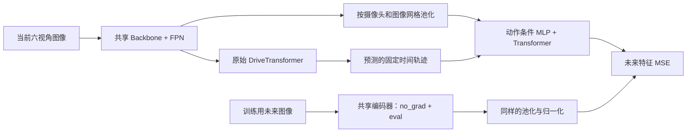

# DriveTransformer + LAW：设计、实现与验证

实现日期：2026-09-11。基线是服务器实际使用的 `dev_wenjj`，commit
`39063526f9873800585da480fb49e91c556d7c0c`；独立分支 `feat/law-latent-20260911`。
没有改动正在运行的主目录、评测队列、P1 工作树或原始 Base 配置。

## 接入思路

LAW 的核心是：用当前视觉特征和**模型预测的自车轨迹**预测未来视觉特征，
通过这个辅助目标同时优化视觉编码器与规划器。

来源：[论文 §4.1–4.3](https://arxiv.org/html/2406.08481v2)、
[官方动作条件编码与世界模型](https://github.com/BraveGroup/LAW/blob/b2f6a784247072923c477ab92324d3aa5a9759bf/projects/mmdet3d_plugin/LAW/dense_heads/waypoint_query_decoder.py)、
[官方停止梯度与损失权重](https://github.com/BraveGroup/LAW/blob/b2f6a784247072923c477ab92324d3aa5a9759bf/projects/mmdet3d_plugin/LAW/LAW.py)。
官方 HEAD 已在本次核验为 `b2f6a784247072923c477ab92324d3aa5a9759bf`。

本实现保留三层动作条件 MLP、Transformer 世界模型、未来目标停止梯度和 MSE。
Decoder 采用官方代码的 `decoder(conditioned, conditioned)` 形式。
这是 LAW 在 DT 上的适配版本，尚不构成对论文全部实验的复现。



### 为什么这样选 latent

DT 的 agent/map query 跨帧索引不保证对应相同对象，直接对相同 query 序号做未来
MSE 会引入错误配对。本版本选择规划器已经使用的 FPN 图像特征：

- 当前 FPN：`[B, 6, 512, H, W]`。
- 每个摄像头池化成 `2×4` 网格，共 `48` 个有序 token；以摄像头顺序、网格行优先排列。
- 对各 token 做无参数 LayerNorm，约束 MSE 的尺度；没有额外可学习的目标投影器。
- 预测端添加可学习的槽位编码，然后通过三层 MLP 和两层 TransformerDecoder。
- 新增 `9,251,328` 个训练参数；保留原来的检测、地图、运动预测、定时/定距规划损失。

这是相对原 LAW 的主要结构适配：原 PV 实现使用学习到的视角查询，本版本采用固定
池化的共享特征。它减少了对 DT 主干的修改，但可能损失小物体细节，需要由消融验证。
本版本没有增加 BEV、图像生成器、EMA 教师或多步 rollout。

### 轨迹条件与梯度

使用最后一层 `ego_fut_preds_fix_time`。当前 Base 为单模态，30 个二维点，
覆盖 3 秒、间隔 0.1 秒。其值已是 lidar 坐标系中的位置，**不再 cumsum**。
把这 60 个预测值拼到每个 latent 上；保留轨迹上的梯度。
未来目标是 1.5 秒时刻，动作输入仍使用完整预测轨迹。

不使用 GT 未来轨迹、GT 模态或 GT 位姿作为世界模型输入。多模态接口按每个样本的
预测模态分数选轨迹；选择索引不可导，选中的轨迹可导。当前验证针对单模态 Base；
多模态分支选择另有单元测试，未运行其他多模态模型的完整训练。

损失：

`L_total = L_DT + λ × mean_valid_pairs(MSE(predicted_future, stopgrad(encoded_future)))`

未来分支只运行 Backbone/FPN 和无参数池化，以 `no_grad` 和临时 `eval` 执行，
结束后精确恢复每个子模块的模式。它不调用 DT head，因此不会更新时序记忆，
不会把未来信息送进当前预测，也不会再次更新 BatchNorm 的统计量。

## 数据处理与边界

配置为向后 15 个样本；按 Bench2Drive 已保存数据的 10 Hz 约定对应 1.5 秒。
本机数据实查首条训练路线帧号连续 `0..108`；预处理程序将图像/标注文件名存为
`frame_idx`。原始标注没有独立时间戳，因此物理时间仍依赖数据集采样约定。
数据换成其他采样频率时，必须同步修改 `frame_idx_step` 和 `frame_period_seconds`。

原数据集的 `timestamp=frame_idx/2` 与上述 10 Hz 约定不同。本次不修改现有
时序记忆的时间约定；LAW 配对独立检查原始帧号，避免把原有模型变化混入实验。

- 必须同一个原始场景，并满足 `future_frame-current_frame=15`。
- 不跨场景补帧，不重复最后一帧充当未来帧。
- 场景尾、缺帧、缺图、摄像头不匹配时，设置无效 mask，并记录具体原因。
- 无效图片只用零占位完成组 batch，**不参与编码、不作为零目标进入损失**。
- 缺失文件会屏蔽；损坏图片/管线异常会直接报错，避免把所有异常都吞掉。
- 未来图像只走图像管线，复用当前样本的 resize/crop/flip/rotate，使用相同归一化。
  修改当前图像管线时，需要同步修改 `law_future_pipeline`。
- 额外的数据只在 `prepare_train_data` 中生成。验证/部署不需要未来图像。
- DDP 按全局有效 pair 数归一化。一张卡有效数为零、全局有效数为零均可反传。

`law_future_meta` 保存当前/未来索引、场景、原始帧号、间隔、摄像头顺序和无效原因。
训练日志有 `loss_law`、未加权 `law_mse`、`law_valid_fraction`、`law_weight`。
未进行整个训练集的配对覆盖率审计，正式实验需关注有效比例，不能只看 MSE。

## 配置与文件

| 用途 | 文件 |
|---|---|
| 完全原始 Base | `adzoo/drivetransformer/configs/drivetransformer/drivetransformer_base.py` |
| Base + LAW | `adzoo/drivetransformer/configs/drivetransformer/drivetransformer_base_law.py` |
| 相同参数/数据/计算量，动作条件置零 | `adzoo/drivetransformer/configs/drivetransformer/drivetransformer_base_law_no_action.py` |
| 世界模型、轨迹选择、DDP 损失 | `adzoo/drivetransformer/mmdet3d_plugin/ours/law.py` |
| 当前/未来分支调度 | `adzoo/drivetransformer/mmdet3d_plugin/ours/drivetransformer.py` |
| 原始帧配对 | `adzoo/drivetransformer/mmdet3d_plugin/datasets/law_pairing.py` |
| 图像加载与 DataContainer | `adzoo/drivetransformer/mmdet3d_plugin/datasets/bench2drive_drivetransformer_dataset.py` |
| 权重调度 | `adzoo/drivetransformer/mmdet3d_plugin/ours/law_hook.py` |

初始设置 `λ=0.2`，前 1000 iterations 从 0 线性升到 0.2。
调度使用 `runner.iter`，恢复训练后保持正确进度。这是本适配的起始超参数，
不是论文最优配置的保证；官方延迟启用 hook 与此线性调度不同。
继承 Base 原有优化器和训练预算，没有自动按 GPU 数重新计算 epoch。

新增配置可直接由原训练入口加载。正式运行前需确定空闲 GPU、共同起点 checkpoint、
全局 batch 和固定步数。下面是一个**尚未执行的四卡、每卡 4 样本、3000 步试验示例**，
其中 GPU 和 checkpoint 路径必须按实际资源填写；这不是已验证的完整训练预算：

```bash
cd /data5T/wenjj/Projects/DriveTransformer_worktrees/law_20260911/DriveTransformer
# 先激活现有 drivetransformer 环境。
export LAW_GPUS='<空闲的四个GPU编号>'
export LAW_BASE_CKPT='/绝对路径/共同起点.pth'
test -f "$LAW_BASE_CKPT" || exit 1
CUDA_VISIBLE_DEVICES="$LAW_GPUS" MASTER_PORT=35291 \
bash adzoo/drivetransformer/dist_train.sh \
  adzoo/drivetransformer/configs/drivetransformer/drivetransformer_base_law.py 4 \
  --load-from "$LAW_BASE_CKPT" --seed 42 --no-validate \
  --work-dir work_dirs/law_pilot \
  --cfg-options data.samples_per_gpu=4 data.workers_per_gpu=4 \
    data.train.cache_lenth=5 runner.max_iters=3000 \
    optimizer.lr=0.00002 checkpoint_config.interval=1000
```

从 Base 加载应使用 `--load-from`，新增的 `law.*` 权重随机初始化；不要把不同参数组
的 Base optimizer 状态当作 LAW 的完整 resume。LAW 自身的后续恢复使用 `--resume-from`。
正式闭环可继续用 LAW 配置；推理不执行新分支，但仍保存其参数，约增加 37 MB FP32 权重。
默认关闭时不注册这些参数，旧 checkpoint 的模型键空间不变。

## 已完成验证

服务器 Python 3.8，PyTorch `2.1.0+cu118`，pytest `8.3.5`。

1. `tests/test_law.py`：13 项通过。包括当前特征/动作梯度、目标停止梯度、无动作消融、
   批内不同模态选择、全部无效、目标 BN 模式恢复、数据边界/缺图、两进程 Gloo DDP。
   DDP 实际梯度与单进程全局有效样本参考结果一致。
2. `tools/law_smoke.py`：真实 Bench2Drive 数据、完整 Base、
   `[2,1,6,3,384,1056]` 当前图像，一个有效 pair、一个场景尾无效 pair。
   使用现有混合精度路径，完整前向、总损失反传成功。
3. 额外检查 LAW 单独损失对 FPN 特征和预测轨迹的梯度均非零；未来输入无梯度，
   时序记忆、BN buffer 和所有子模块模式在未来分支执行前后不变。
4. 同权重/同输入/同随机种子下，关闭 LAW 后的训练日志与从基线 SHA 提取的原始
   `forward_train` 结果完全相同。实际推理入口不调用 LAW，开关两种情况所有 tensor
   输出逐项相同，无需未来图像。
5. 峰值分配显存约 6.88 GiB，整段检查约 13.86 秒；这是上述短时检查的测量值，
   **不是完整训练（含优化器状态）显存估算，也不是吞吐基准**。

原始结果：[真实 batch 检查 JSON](law_validation/real_batch_smoke.json)。

复查命令：

```bash
python -m pytest -q tests/test_law.py
CUDA_VISIBLE_DEVICES='<单个空闲GPU>' python tools/law_smoke.py \
  --output work_dirs/law_smoke.json
```

未完成的实验：完整训练、多卡整模型训练、正式 checkpoint 闭环评测及收益判定。
随机初始化时的损失仅用于验证数值和梯度，不能作为性能结果。

## 建议的第一轮对照

| 组别 | 唯一目标差别 | 回答的问题 |
|---|---|---|
| A：Base 继续训练 | 无 LAW | 相同步数的继续训练本身是否改善 |
| B：Base + 无动作 LAW | 预测未来，不使用动作 | 收益是否来自未来特征监督 |
| C：Base + LAW | 未来特征监督加入预测轨迹 | 动作条件是否有额外收益 |

三组从同一个 Base checkpoint 出发，锁定数据划分、训练 seed、全局 batch、迭代数、
学习率、数据增强、评测路线、控制器、timeout 和重试规则。B/C 参数结构完全相同。
先确认有效 pair 覆盖、MSE、规划损失和梯度稳定，再做共同 route_id 上的配对闭环比较，
保留缺失路线及原因。不能把本分支与既有 dropout/sin_heading/P1 改动混成一组后
直接归因给 LAW，也不能把论文中的改善当作此实现的预期增幅。
