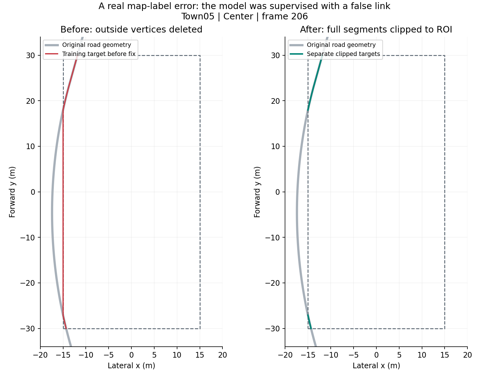
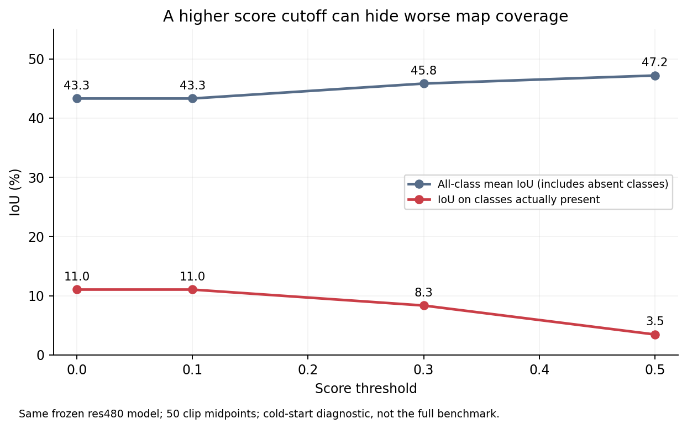

# DriveTransformer mapping 代码检查与修复

2026-09-17；任务 MAP-AUDIT-FIX-001；源码起点为模型主线 `dev_wenjj@89ea00f903852aa42934478234a267fe70a2f65b`，独立分支 `fix/mapping-20260917`。

**结论：已经找到并修复可复现的地图标签和训练边界问题。最值得先验证的是消除重复监督，其次是正确裁剪地图折线。尚不能将这些问题认定为全部 mapping 退化的唯一原因，也没有得到修复后重训的质量成绩。**

本轮检查了数据生成、点序等价匹配、归一化、分类/点坐标/方向损失、地图查询展开与汇总、推理解码及评分方式。核验了主线、P1、LAW、res480 的版本和文件哈希；在独立目录实施修改，已有模型运行目录保持原版本。没有启动长期训练、闭环仿真或修改原始数据文件。

**1. 重复地图标签会占用查询和监督预算，发生比例高。**

从 950 个训练片段等间隔选取 100 个，每个取首、中、末帧；验证集覆盖全部 50 个片段，也各取 3 帧。以下是 450 帧抽样结果，不代表全数据集普查。

| 检查项 | 训练：300 帧 | 验证：150 帧 |
|---|---:|---:|
| 原地图实例数 | 9,725 | 5,179 |
| 同类别、完全相同几何的重复实例 | 3,126（32.14%） | 1,447（27.94%） |
| 原 GT 超过 50 条的帧数 | 55 | 29 |
| 精确去重后 GT 超过 50 条的帧数 | 23 | 18 |
| 原 GT 超过 100 条的帧数 | 10 | 4 |
| 精确去重后 GT 超过 100 条的帧数 | 2 | 0 |

重复判定要求同一类别并且 Shapely `equals` 几何相等，包括反向点序；边界取整仅用于检索候选，不用于最终相等判定。没有把相距几厘米的平行线合并。另有更宽松的 5 cm 采样匹配统计，未用它决定删除。

代码中的 Hungarian 匹配是一对一匹配：重复 GT 会要求不同 query 拟合同一条线。它还会重复计算点/分类损失。在地图 query 固定为 100、默认最多解码 50 个候选的情况下，这会挤占表示其他地图元素的容量。这是明确的监督冗余；实际性能改善幅度必须用训练消融确认。

新增 `map_deduplicate=True` 后，只保留同类别、相同几何的一个标签。所有历史配置默认仍为 False，新的训练配置显式开启；验证/测试 GT 保留历史口径。

**2. ROI 筛点会生成原道路中不存在的直线，并漏掉跨界短段。**

原逻辑先删去 ROI 外的点，再将所有剩余点组成一个 `LineString`。如果道路先离开 ROI 再返回，两段内部道路就被直接连接。训练抽样中发现 3 帧/5 条，验证抽样中发现 4 帧/8 条；被连接的间隔弦长分别合计约 116.19 m 和 197.82 m。此外发现 13/6 个跨界片段因保留点不足而丢失。该问题出现频率低于重复监督，不能单独解释所有帧的地图质量。

上图是真实 Town05 样本的一条 Center 线。灰色为原道路，虚线框为 ROI；左图红色长线是旧训练标签人为生成的连接，右图正确保留了两段独立道路。此图展示的是 **GT 修复**，不是模型预测提升。

新增 `map_clip_mode='geometric'`：计算完整线段与 ROI 的交集、保留分离片段、保留边界交点，并过滤零长度线。先以线段包围盒缩小输入，再做几何裁剪，避免为远离 ROI 的大量密集点构造几何对象。旧配置可继续用 `'legacy'` 复现历史标签。

该筛点逻辑在[DriveTransformer 官方数据集实现](https://raw.githubusercontent.com/Thinklab-SJTU/DriveTransformer/main/adzoo/drivetransformer/mmdet3d_plugin/datasets/bench2drive_drivetransformer_dataset.py)中也存在。TrafficLight/StopSign 仍按原定义保留完全位于 ROI 内的触发区闭合轮廓；部分可见轮廓是否应加入监督，需要单独设计，未与车道裁剪混合修改。

**3. 修复了 head 的空地图监督和点数兼容问题，但它们不是本次抽样中的主要退化来源。**

- 原来空地图帧会借用其他帧的伪 GT，并把地图损失整体屏蔽；首批全空还可能触发断言。现在直接使用空目标，让分类分支学习背景，几何分支获得零损失；标签不再被原地替换，空标签为 int64。
- 点目标张量按 GT 点数分配，修复预测点数与 GT 点数不一致时的赋值形状问题，后续插值按原设计工作。当前正式配置两者均为 20，因此不是现有模型差的解释。
- 本次 450 帧没有空地图帧；空帧修复通过合成回归样本验证。非空样本的既有 Hungarian、等价点序、归一化 L1、方向损失和各层监督继续保留。

**4. 后处理存在可改善的接口行为，但调高阈值无法解决几何能力问题。**

原 coder 对所有 query×类别分数直接 top-k，同一条几何可用多个类别重复出现；这一设计也见于[官方 coder](https://raw.githubusercontent.com/Thinklab-SJTU/DriveTransformer/main/adzoo/drivetransformer/mmdet3d_plugin/core/bbox/coders/map_nms_free_coder.py)，不把这种常用多类别排序直接定性为算法错误。已增加 `unique_queries=True` 可选模式，每个 query 只保留一个类别；默认排序方式保持原样。

另外，旧实现会在全部分数低于阈值时自动降低阈值，直到留下预测。现在显式阈值默认严格生效，允许空输出；需要重现旧行为可设置 `adaptive_score_threshold=True`。当前常用配置没有设置 coder 阈值，因此此修复不能解释历史模型退化。较少/空 query 输入也不再因 top-k 数量过大而崩溃。

使用原 res480 `iter_29350.pth`，在 50 个验证片段的中间帧分别重置记忆，进行一次前向，再对相同输出张量比较解码策略。原 decoder 的点、类别、分数与正常模型输出逐位一致，权重严格加载。**这是 50 帧冷启动诊断，不是原 12,806 帧连续评估，数值不可与正式排行榜直接比较。**

| 策略 | 平均输出数 | 全类别平均 IoU | GT 中实际存在类别的 IoU | 相应像素召回 |
|---|---:|---:|---:|---:|
| 原 flat top-50，阈值 0 | 31.00 | 0.4332 | 0.1104 | 0.1766 |
| 每 query 单类别 top-50，阈值 0 | 31.84 | 0.4361 | 0.1093 | 0.1787 |
| 每 query 单类别 top-100，阈值 0 | 73.24 | 0.4103 | 0.1444 | 0.3300 |
| 原 flat top-50，阈值 0.3 | 20.46 | 0.4584 | 0.0834 | 0.1283 |
| 原 flat top-50，阈值 0.5 | 5.80 | 0.4720 | 0.0345 | 0.0472 |

范围过滤后输出数可能小于 top-k。top-100 提高了召回，同时实际存在类别的像素精度从 0.2291 降到 0.2110，不能据此直接替换默认配置。单纯每 query 选一个类别没有显示明确的几何收益。

现有 IoU 脚本对 GT/预测都没有的类别记 1。提高阈值会删掉一些空类别误检，从而提高全类别平均分，但也会严重损害真实地图覆盖。0.5 阈值的实际存在类别 IoU 降至 0.0345，说明“画面干净”和“地图能力更强”必须分开。后续应同时报告分类型 IoU、实际存在类别 IoU、精度/召回和固定失败帧，避免只看一个平均数。

**验证与交付。**

- 新增 18 项 mapping 回归测试全部通过；连同原检查共 44 项，42 通过、2 项 CUDA 专项在 CPU 测试进程中跳过。涵盖出界再入界、跨界线、随机折线与完整几何交集一致、精确去重/不合并相邻线、空 GT 分类梯度、等价反向点序、预测/GT 点数不同、严格阈值、旧行为及空预测。
- 进一步通过真实 dataset 接口验证 57 帧（训练 30、验证 27）：包含抽样中全部错误连接和漏掉的跨界片段、最密集帧及均匀抽样帧。修复后的每类线集合与原始完整道路的 ROI 几何交集一致，最大 Hausdorff 误差为 0；重复标签消除，20 点采样均有限。这是针对性验证，区别于上面的 450 帧标签统计。
- 另在 A100 空闲 GPU2 完成上述 50 帧真实推理，及 **1 个真实训练样本的完整前向/反向**。旧 res480 权重严格加载；最终层 map 分类/点/方向损失为 0.45334 / 0.44408 / 0.00006582，全部参数梯度有限，地图分类、回归、位置编码和骨干均有非零梯度。峰值分配约 3.79 GiB。没有 optimizer 更新；这些结果不代表 batch20×4 的吞吐、稳定收敛或训练收益。
- 可移植对照配置与已完成 res480 的模型、优化器、学习率调度、runner、数据设置及推理协议核对一致；只有输出目录、日志以及显式的旧地图开关等非模型差别。新消融配置只改变训练标签，验证/测试配置一致。
- 完整摘要、输入和权重哈希在 [evidence.json](evidence.json)，测试在 [tests_final.log](tests_final.log)。原始抽样 JSON、50 帧原始网络输出及初次诊断脚本错误日志保留在本任务本地目录和 A100 独立目录。首次解码探针混用 CPU/GPU top-k，因相同分数的排序不同导致一致性检查失败；最终探针统一在 GPU 上解码。首次反向探针遗漏项目训练需要的 `wrap_fp16_model`，最终已按真实 runner 的初始化方式修正。

**下一步按“有什么问题、具体改什么、看什么结果”实施。**

优先完成只去重的受控训练，因为它影响的样本最多。使用 `drivetransformer_res480_p1_map_dedup.py`；保持 480×960、100 queries、每线 20 点、ResNet 预训练/其余从头、20×4 和 29,350 步不变。与同预算 control 比较完整验证集地图分类/几何、实际类别召回、检测/运动/规划；有地图收益且其他任务无明显回退后再做闭环验证。正式训练前仍需核验 GPU 资源和 batch20 的短跑；本轮未安排长期作业。

裁剪单因素配置是 `drivetransformer_res480_p1_map_clip.py`，组合是 `drivetransformer_res480_p1_map_datafix.py`。可先利用已有 res480 成绩做探索性参照，严格因果比较需要同代码与预算的 control，不能把配置准备/反向通过当作消融完成。

若标签修复后单帧形状仍差，再测试跨层保留点特征。当前 decoder 每层输出点坐标，然后用 `map_query.mean(-2)` 汇总点内容特征；这可能限制局部几何，但不是已证明的 bug。应固定 query/点数和训练预算单独验证，然后再考虑 stride-32 单尺度之外的局部多尺度图像采样。不能一次替换 BEV/PV、点状态、损失和标签后，声称某个组件带来提升。
